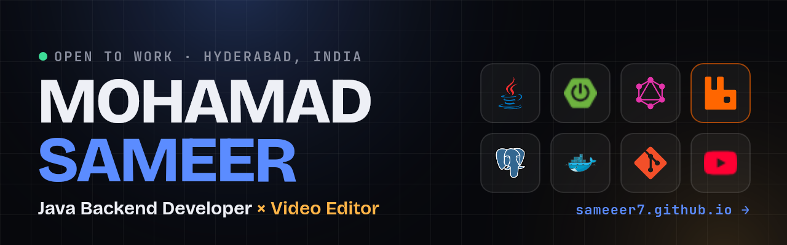
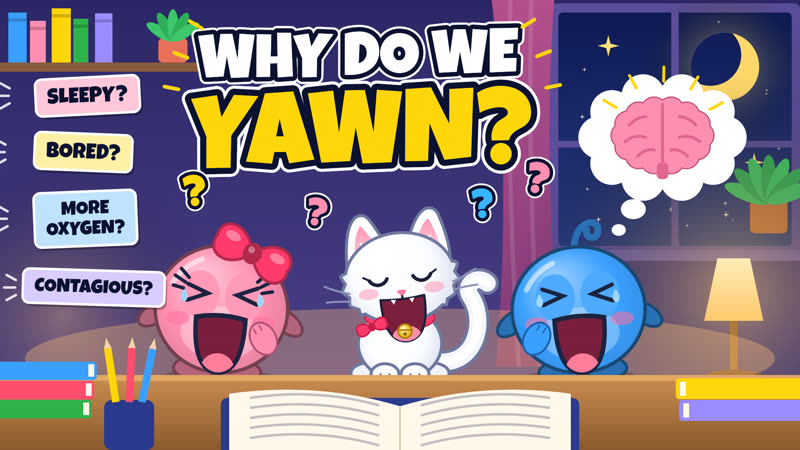
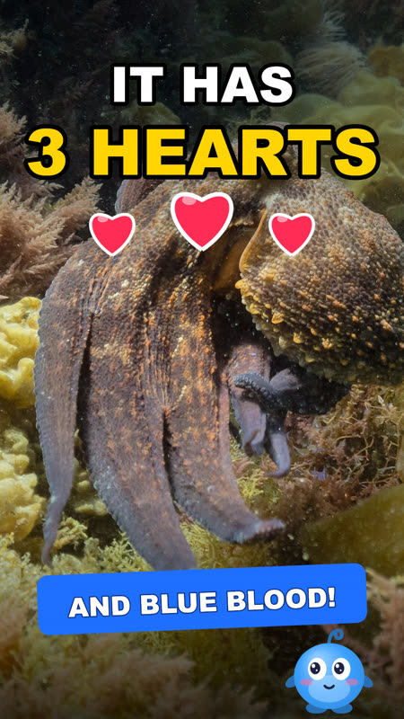

  

  
  
  
  

## 👋 Hi, I'm Sameer

I'm a **Java backend developer** who builds reliable APIs and integrations, and a **video editor** who runs his own YouTube channel.

- ⚙️ **1.5 years** building Spring Boot services for retail and POS platforms at **CW Suite**
- 🐇 Built **RabbitMQ** producers and consumers that turn store orders into backend orders asynchronously
- 🔌 Delivered **3 client integrations end to end** (Shopify, Reelo, Nukkad POS)
- 🧹 Picked for a 3-person **Data Integrity** team to fix production data with SQL and PL/pgSQL
- 🎬 I write, voice, edit and publish every video on **[Begin With Sam](https://youtube.com/@beginwithsam)**
- 📍 Hyderabad, India · **Open to Java Backend roles · Immediate joiner**

## 🧰 Tech stack

  &nbsp;
  &nbsp;
  &nbsp;
  &nbsp;
  &nbsp;
  &nbsp;
  &nbsp;
  &nbsp;
  &nbsp;
  &nbsp;
  &nbsp;
  &nbsp;
  &nbsp;
  &nbsp;
  

**Backend:** Java 8 · Spring Boot · Spring MVC · Spring Security · JDBC · REST · GraphQL · Webhooks
**Messaging & data:** RabbitMQ · PostgreSQL · MySQL · Redis (basics) · SQL · PL/pgSQL
**Learning now:** Spring Data JPA · Microservices · Docker · JUnit · Resilience4j
**Video:** CapCut · InShot · ElevenLabs · Google Flow · Scriptwriting · Sound design

## 🚀 Featured work

| Project | What I built | Stack |
|---|---|---|
| **Shopify ⇄ CW Suite** · *Kamal Watches* | Two-way product sync, inventory sync, and a queue pipeline that turns Shopify order webhooks into CW Suite orders with customer, payment and tax data | Spring Boot · RabbitMQ · REST · Webhooks |
| **Reelo Loyalty & Coupons** · *Indian Sweet House* | Loyalty points and coupons inside the POS with OTP login; POS orders published as JSON and consumed to create orders | Spring Boot · RabbitMQ · JSON |
| **Nukkad POS Batch Sync** · *Dadu's Sweets* | Twice-daily scheduled jobs pulling 80–100 orders a day for two airport units, with idempotent inserts (zero duplicates) and monthly reports | Spring Boot · Scheduler · PostgreSQL |
| **[Portfolio website](https://sameeer7.github.io)** · [repo](https://github.com/sameeer7/sameeer7.github.io) | Animated portfolio with smooth scroll, 3D hover, a scroll-scrubbed edit timeline and an Engineer ⇄ Editor mode | HTML · CSS · JavaScript · GSAP |

Client integrations were built for CW Suite; that source code is private.

## 🎬 Video work: Begin With Sam

Animated explainers for kids and parents, starring Sam, Rosy and Coco. I handle the script, visuals, voice-over, music, edit, subtitles and thumbnail myself.

  
  
  

## 🎓 Education

- **B.Tech, Mechanical Engineering**: Swarnandhra College of Engineering & Technology · CGPA 8.39
- **Spring Boot 0 → 100, Cohort 5.0**: Coding Shuttle (advanced Spring Boot, DevOps, system design) · 2026, ongoing
- **Java Full Stack Development**: Vcube Software Solutions, Hyderabad · 2024

---

<b>Hiring a Java backend developer?</b> Let's talk: <a href="mailto:sameer.mohamad.m@gmail.com">sameer.mohamad.m@gmail.com</a>

